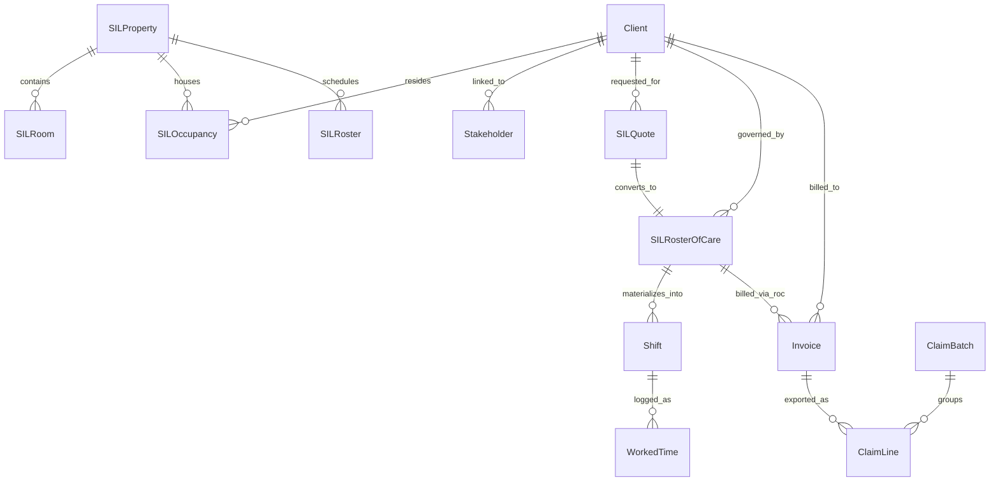
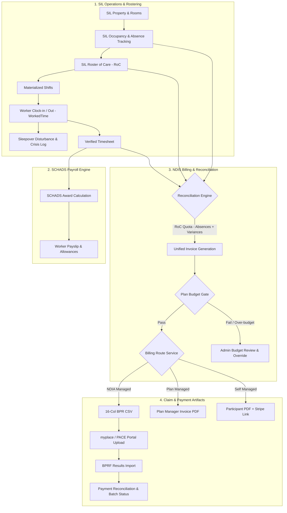

# NDIS + SIL Management & Invoicing Integration — Master Architecture & Gap Analysis

**Status:** Living Document · **Last Updated:** 2026-11-02  
**Target Audience:** Autonomous Agents, Lead Engineers, NDIS Compliance Officers, and Product Owners  
**Companion Documents:**
- [`docs/SIL_MANAGEMENT_SPEC.md`](./SIL_MANAGEMENT_SPEC.md) — Phase 4 SIL Operations, Quoting, and RoC Spec
- [`docs/NDIS_DEPTH_ROADMAP.md`](./NDIS_DEPTH_ROADMAP.md) — Master Roadmap for SCHADS, Notes, Stakeholders, Claiming
- [`docs/NDIS_DEPTH_GUIDE.md`](./NDIS_DEPTH_GUIDE.md) — Testing, Configuration, and Walkthrough Guide
- [`AGENTS.md`](../AGENTS.md) — Repository Rules, Environments, and Conventions

---

## 1. Executive Summary & Context

**CareNest** is an Australian NDIS workforce and billing management platform designed for disability service providers. A core competitive differentiator for NDIS providers is the seamless, compliant lifecycle of **Supported Independent Living (SIL)**:
1. Defining physical houses (**Properties**) and room capacity (**Occupancy**).
2. Quoting support hours based on participant needs (**SIL Quotes**).
3. Translating accepted quotes into approved rosters of care (**Roster of Care / RoC**).
4. Scheduling staff with strict staff-to-participant ratio compliance (**SIL Rosters & Shifts**).
5. Logging actual shift delivery and sleepover/active night conditions (**Timesheets / WorkedTime**).
6. Generating compliant billing artifacts:
   - **NDIA-Managed**: 16-column Bulk Payment Request (BPR) CSV for the myplace/PACE portal.
   - **Plan-Managed**: Tax Invoice PDF addressed to the participant's Plan Manager stakeholder.
   - **Self-Managed**: Tax Invoice PDF addressed to the participant/nominee with Stripe payment links.
7. Reconciling payment claims, tracking NDIS plan budgets, and calculating SCHADS Award worker pay.

### The Problem Statement
While the codebase contains sophisticated implementations across SIL quoting, roster publishing, SCHADS Award calculations, and bulk claiming, **critical architectural seams and disconnections exist between actual shift execution, SIL roster management, and invoice generation**. 

Specifically:
- Invoicing for SIL currently relies on **theoretical mathematical proration of agreed weekly hours**, completely bypassing the actual clock-in/out records (`WorkedTime`).
- Multiple disjoint billing pipelines exist in the backend (one for 1:1 appointments, one for SIL RoCs, one for bulk actions), each using incompatible schema conventions.
- Participant absences (hospital, holidays) and dynamic ratio changes (e.g. 1 of 3 residents is away, changing the billing ratio from 1:3 to 1:2) cannot be automatically accounted for during billing.
- Several high-value backend capabilities (e.g. NDIS cancellation billing, provider travel claims, plan budget gates) are either disconnected from the mobile UI or lack domain-model parity on the Flutter frontend.

This document serves as the **definitive, living source of truth** detailing exactly where the system connects today, where it lacks connections or features, and the exact technical steps needed to bring the platform to full production maturity.

---

## 2. System Architecture & Current Connections

### 2.1 Domain Model Landscape



### 2.2 What Is Currently Connected (The Solid Foundation)

| Connection Point | Implementation Files | Status | How It Works Today |
|---|---|---|---|
| **SIL Operations & Vacancy Board** | `backend/services/silPropertyService.js`<br>`backend/services/silOccupancyService.js`<br>`lib/app/features/sil/` | ✅ Complete | Properties have rooms and vacancy tracking. `SILOccupancy` tracks resident assignment with a partial unique index preventing double-booking rooms. |
| **SIL Quoting & Price Cap Check** | `backend/services/silQuoteService.js`<br>`backend/services/priceValidationService.js` | ✅ Complete | Quote line items are validated against NDIS price caps prior to acceptance. Accept blocks on cap violation. |
| **Quote → Roster of Care (RoC)** | `backend/services/silQuoteService.js:convertQuote`<br>`backend/models/SILRosterOfCare.js` | ✅ Complete | Accepted quotes convert directly into an active `SILRosterOfCare` with agreed weekly support items. |
| **RoC → Shift Materialization** | `backend/services/silRosterService.js:materializeRocShifts`<br>`backend/models/Shift.js` | ✅ Complete | Active RoC agreed weekly patterns materialise into unassigned `Shift` records tagged with `silRosterOfCareId`. |
| **RoC → Invoice Generation** | `backend/services/silBillingService.js`<br>`backend/controllers/silController.js:450` | ✅ Complete | `POST /api/sil/rosters-of-care/:id/invoice` prorates weekly hours over a date range (`weeks = days / 7`) and creates an `Invoice`. |
| **Funding Route to Artifact** | `backend/services/billingRoutingService.js`<br>`backend/models/Invoice.js:104` | ✅ Complete | Pre-save hook stamps `Invoice.billing`: `ndia_managed` → `claim_csv`; `plan_managed` → `invoice_pdf` (to plan manager); `self_managed` → `invoice_pdf` (to participant). |
| **NDIA Bulk Payment Request (BPR)** | `backend/services/ndisClaimService.js`<br>`lib/app/features/claiming/` | ✅ Complete | Generates 16-column myplace BPR CSV (`DD/MM/YYYY`, unique `claimReference`, ABN check). Reconciles via BPRF import. |
| **SCHADS Award Engine** | `backend/services/schadsService.js`<br>`backend/config/schadsRates.js` | ✅ Complete | Time-segmented, timezone-aware (`Australia/Sydney`) award engine splitting at 06:00/20:00/24:00, handling weekend/public holiday rates and overtime. |
| **NDIS Plan Budget Gate** | `backend/services/planBudgetService.js` | ✅ Complete | Validates that invoices fall within active plan dates and do not exceed category or total budgets before issuing. |

---

## 3. In-Depth Gap Analysis: Where It Lacks Connection

We have identified **12 Critical Dimensions** where connections are broken, incomplete, or missing entirely.

---

### Gap 1: Actual Worked Hours (`WorkedTime`) vs RoC Theoretical Billing Disconnect
* **Severity:** 🔴 **CRITICAL (P0)** — High Audit & Revenue Risk
* **Current Behavior:**  
  When billing a SIL participant via `silBillingService.generateInvoiceFromRosterOfCare`, the service computes billable quantity strictly from the static RoC template:
  ```javascript
  // backend/services/silBillingService.js:107-113
  const quantity = isSleepover
    ? round2((daysPerWeek || Math.max(1, Math.round((Number(support.hoursPerWeek) || 0) / 8))) * weeks)
    : round2((Number(support.hoursPerWeek) || 0) * weeks);
  ```
  It **completely ignores** `backend/models/WorkedTime.js` and `backend/models/Shift.js`.
* **The Disconnect:**  
  1. If a support worker fails to attend a shift or clocks out early, the participant is still billed the full theoretical quota (risk of NDIA non-compliance audit and clawbacks).
  2. If emergency 1:1 support or crisis overtime was delivered at the house, it is logged in `WorkedTime` with `silShiftId`, but `silBillingService` never detects or bills it.
  3. Workers are paid based on `WorkedTime` (SCHADS engine), but clients are billed on `SILRosterOfCare`. When these diverge, the provider suffers unbilled payroll leakage or non-compliant overbilling.
* **Required Connection:**  
  Add a **Reconciliation Billing Mode** to `silBillingService`:
  - Mode A: *Roster of Care Quota* (fixed weekly quotient for stable shared living).
  - Mode B: *Actual Verified Timesheets* (queries `WorkedTime.find({ silShiftId: { $in: propertyShiftIds } })`, splits shared hours across active residents, and bills true delivered hours).
  - Mode C: *Hybrid* (standard RoC quota + billed variances/unplanned 1:1 hours).

---

### Gap 2: Disjoint & Incompatible Invoicing Pipelines
* **Severity:** 🔴 **CRITICAL (P0)** — Code Duplication & Schema Corruption
* **Current Behavior:**  
  The codebase contains three separate, mutually incompatible invoice generation services:
  1. `backend/services/invoiceGenerationService.js`:
     Requires a `ClientAssignment` document (`lines 386-394`). Fails with `'No active assignment found'` if run on SIL shifts or properties.
  2. `backend/services/silBillingService.js`:
     Creates an `Invoice` with embedded `lineItems: [lineItemSchema]` and calls `invoiceManagementService.createInvoice()`.
  3. `backend/services/bulkInvoiceService.js`:
     Directly instantiates `new Invoice()` and writes to separate `InvoiceLineItem.insertMany()`. **Critically buggy**: hardcodes `invoice.tax = subtotal * 0.1` (`lines 86, 102`), illegally charging 10% GST on GST-free NDIS supports!
* **The Disconnect:**  
  There is no unified domain engine for invoice creation. Different screens call different services with different schemas, validation rules, and tax logic.
* **Required Connection:**  
  Deprecate the ad-hoc generation in `bulkInvoiceService.js` and `invoiceGenerationService.js`. Consolidate all billing through `InvoiceManagementService.createInvoice()`, ensuring all paths use the unified NDIS GST-free rule, NDIS price-cap validation, and `billingRoutingService`.

---

### Gap 3: Participant Absences & Dynamic Ratio Fluctuations in SIL
* **Severity:** 🟠 **HIGH (P1)** — NDIS Compliance & Operational Accuracy
* **Current Behavior:**  
  `SILOccupancy` only tracks `status: 'active' | 'ended'`.
  ```javascript
  // backend/models/SILOccupancy.js
  status: { type: String, enum: ['active', 'pending', 'ended', 'cancelled'], default: 'active' }
  ```
* **The Disconnect:**  
  1. **NDIS Temporary Absence Rules:** Under NDIA guidelines, when a SIL participant is admitted to hospital or away on leave, providers can only claim SIL for up to 28 consecutive days (or up to 60 days in approved circumstances). After that, claims must pause. Currently, `silBillingService` has no awareness of client hospital stays or holidays and continues to bill uninterrupted.
  2. **Ratio Shift Impact:** In a 3-person house with 1 staff (1:3 ratio): if Resident A is in hospital, the house becomes 2 residents with 1 staff (1:2 ratio). The NDIS support item code for 1:2 is different (and has a higher per-person rate) than 1:3. The app currently has no mechanism to adjust ratios and support item codes based on temporary resident absences.
* **Required Connection:**  
  - Add `SILAbsence` model or expand `SILOccupancy` with `absences: [{ startDate, endDate, reason: ['hospital', 'family_leave', 'holiday', 'other'], claimedDays: Number, maxClaimableDays: { type: Number, default: 28 } }]`.
  - Update `silBillingService` to prorate deductions or flag when a participant has exceeded 28 consecutive days of absence.
  - Implement dynamic ratio re-evaluation in `silRatioService` based on *present* residents on any given date.

---

### Gap 4: Frontend Client (`Patient`) Model Parity with Backend Schema
* **Severity:** 🟠 **HIGH (P1)** — Frontend Data Loss & Brittle UI
* **Current Behavior:**  
  In `backend/models/Client.js`, the participant record includes:
  - `plan: { startDate, endDate, totalBudget, categories: [{ categoryNumber, name, budget }], status }`
  - `sil: { propertyId, roomId, rosterOfCareId }`
  - `stakeholders: [{ stakeholderId, role, isPrimary }]`
  - `ndisNumber: String`
  - `fundingType: enum`
  
  However, in Flutter's `Patient` model (`lib/app/features/client/models/client_model.dart`):
  ```dart
  class Patient {
    final String? id;
    final String? clientFirstName;
    // ...
    final String? ndisNumber;    // Mapped
    final String? fundingType;   // Mapped
    // MISSING:
    // final ClientPlan? plan;
    // final ClientSilContext? sil;
    // final List<ClientStakeholderRef>? stakeholders;
  }
  ```
* **The Disconnect:**  
  Because `plan` and `sil` are not part of the typed `Patient` model, Flutter views (like `client_list_view.dart`) must make raw `Map<String, dynamic>` API calls or bypass the repository layer to inspect plan budgets and SIL house assignments.
* **Required Connection:**  
  Migrate `Patient` to a proper `@freezed` class `ClientModel` that includes typed nested models for `ClientPlan`, `ClientPlanCategory`, `ClientSilRef`, and `ClientStakeholderRef`. Run `build_runner` to regenerate serialization code.

---

### Gap 5: Short-Notice Cancellations (NSCC / NSDH) UI Disconnect
* **Severity:** 🟡 **MEDIUM (P2)** — Revenue Recovery
* **Current Behavior:**  
  The backend has a complete, tested service (`backend/services/cancellationBillingService.js`) and endpoint (`POST /api/ndis-claims/cancellations`) that creates cancellation invoices tagged with `claimType: 'CANCELLATION'` and `cancellationReason: 'NSCC' | 'NSDH'`.
  The frontend `ApiMethod` class also has the wrapper:
  ```dart
  // lib/backend/api_method.dart:4690
  Future<Map<String, dynamic>> createCancellationClaim({...})
  ```
* **The Disconnect:**  
  `createCancellationClaim` is **never called anywhere in the Flutter UI**. When an appointment or shift is cancelled in `schedule_dashboard_screen.dart` or `appointment_list_screen.dart`, the user is not prompted whether the cancellation is billable under the NDIS 7-day rule, nor can they select the cancellation reason (`NSCC` vs `NSDH`). The shift is simply marked `cancelled` and lost to billing.
* **Required Connection:**  
  In the shift cancellation modal, add an NDIS compliance check:
  - If notice < 7 days (or funding route requires it), prompt: *"Bill as NDIS Short-Notice Cancellation (100% cap)?"*
  - Dropdown: `NSCC` (Participant Short Notice) / `NSDH` (No Show / Denied Access).
  - Trigger `createCancellationClaim` so the line item flows directly into the NDIA claim CSV or plan manager invoice.

---

### Gap 6: Provider Travel & Kilometres for SIL
* **Severity:** 🟡 **MEDIUM (P2)** — Operational Expense Leakage
* **Current Behavior:**  
  `backend/services/providerTravelService.js` can bill both labour travel minutes and non-labour travel kilometres (using MMM regional multipliers).
* **The Disconnect:**  
  In SIL group homes, participant community access and transport (e.g. driving 3 residents to a day program) is activity-based transport.
  Currently:
  1. `Trip` logs are associated with a single `clientEmail`, making it impossible to split vehicle mileage among 3 SIL residents sharing the vehicle.
  2. SIL shift materialization does not provide a travel allowance entry point.
  3. The provider absorbs vehicle wear-and-tear instead of claiming NDIS activity-based transport (Item `01_799_0107_1_1`).
* **Required Connection:**  
  Allow `Trip` records to link to a `propertyId` or multiple `clientIds`. In `providerTravelService`, implement multi-participant distance splitting (e.g. 30 km trip / 3 participants = 10 km billed to each participant).

---

### Gap 7: Sleepover Disturbance Tracking & Active Night Conversion
* **Severity:** 🟡 **MEDIUM (P2)** — Fair Work / SCHADS Compliance
* **Current Behavior:**  
  In `SILRosterEntry` and `Shift`, the shift type is statically set to `sleepover` or `active_night`.
  In `silBillingService.js:107`, sleepover is billed with unit `'E'` (Each) as a flat fee.
* **The Disconnect:**  
  Under the SCHADS Award (Clause 25.7) and NDIS pricing rules:
  - A sleepover covers a continuous period of 8 hours where the worker sleeps.
  - If the worker is required to perform work during the sleepover (e.g., attending to a participant's distress or medical need), **the sleepover is disturbed**.
  - If work exceeds 1 hour (or multiple disturbances occur), the time must be paid and billed as **Active Night (Hourly) at overtime/night penalty rates**.
  - The mobile app currently has no "Log Disturbance" button during active sleepover shifts.
* **Required Connection:**  
  - Add `disturbances: [{ startTime: Date, endTime: Date, reason: String, notes: String }]` to `WorkedTime`.
  - When clocking out of a sleepover shift, if disturbances total > 60 minutes, automatically convert the shift to active night in SCHADS payroll and append active night hours to the billing line items.

---

### Gap 8: Service Agreements, Participant Consent & PACE Alignment
* **Severity:** 🟡 **MEDIUM (P2)** — Governance & Legal Audit Readiness
* **Current Behavior:**  
  The flow currently goes: `SILQuote` → Accept → `SILRosterOfCare`.
* **The Disconnect:**  
  NDIS Quality and Safeguards Commission rules require an executed **Service Agreement** before delivering SIL supports.
  The agreement must specify:
  - Agreed support hours and participant contribution to board/lodging.
  - Plan manager contact and authorization for direct claiming.
  - Nominee consent and PACE endorsement.
  Currently, there is no `ServiceAgreement` model or document storage linking quotes, sign-off dates, and PDF contracts.
* **Required Connection:**  
  Introduce an additive `ServiceAgreement` entity linking `clientId`, `quoteId`, `status: ['draft', 'sent', 'signed', 'expired']`, signed PDF artifact URL, and expiry date. Enforce that an RoC cannot be activated without a linked signed agreement (or an explicit admin bypass).

---

### Gap 9: Multi-Payer Split Routing & Combination Funding Support
* **Severity:** 🟡 **MEDIUM (P2)** — Complex Participant Billing
* **Current Behavior:**  
  `Client.fundingType` supports `['ndia_managed', 'plan_managed', 'self_managed', 'combination']`.
  However, when `fundingType == 'combination'`, `billingRoutingService.js` does not have line-level routing logic.
* **The Disconnect:**  
  Many participants have **combination funding**:
  - SIL supports (Category 01 - Assistance with Daily Living) are **NDIA-Managed**.
  - Therapy supports (Category 15 - Capacity Building) are **Plan-Managed**.
  - Consumables (Category 03) are **Self-Managed**.
  Currently, the system assigns a single `artifact` (`claim_csv` or `invoice_pdf`) to the entire invoice. If an invoice contains mixed items, NDIA rejects the entire CSV file for unapproved support items.
* **Required Connection:**  
  Support line-item level funding routes in `InvoiceLineItem` / `SILQuoteLine`:
  Each line item indicates its own `fundingRoute` (`ndia`, `plan_manager`, `self`), allowing the invoice generator to split a mixed service delivery into an NDIA Claim Batch AND a Plan Manager PDF.

---

### Gap 10: NDIS Price Guide Versioning & Regional Loading
* **Severity:** 🟡 **MEDIUM (P2)** — Pricing Integrity
* **Current Behavior:**  
  The support catalog is loaded from a static `assets/ndis_support_items.json` file. Prices are strings.
* **The Disconnect:**  
  1. The NDIA publishes updated pricing annually (every July 1st) and occasional interim updates. When prices change, historical quotes and invoices must retain the old rates, while future ones use new rates.
  2. NDIS allows regional pricing adjustments based on the Modified Monash Model (MMM 1-7):
     - Remote (MMM 6): +40% allowance.
     - Very Remote (MMM 7): +50% allowance.
     The backend `pricingMetadata` in `Invoice.js` stores `mmmRating` and `mmmMultiplier`, but `silBillingService` does not apply MMM multipliers when calculating RoC line prices.
* **Required Connection:**  
  - Apply MMM postcode lookup when calculating SIL property line items (using `SILProperty.address.postcode`).
  - Add `effectiveDate` to support items so price lookups are historical-date aware.

---

### Gap 11: Sleepover Allowance vs Ordinary Hours in SCHADS Integration
* **Severity:** 🟢 **LOW / REFINEMENT (P3)** — Payroll Precision
* **Current Behavior:**  
  `backend/services/schadsService.js` calculates award penalties.
* **The Disconnect:**  
  Under SCHADS Award Clause 25.7, a sleepover is paid as a flat **sleepover allowance** (indexed to the standard rate), plus ordinary hours for any daytime portion before/after the sleepover. If a shift is entered as 10pm to 8am sleepover, the engine must not calculate 10 hours of ordinary base rate + night penalty; it must calculate the fixed sleepover allowance + 2 hours of morning support.
* **Required Connection:**  
  Ensure `schadsService.js:segmentShift` recognizes `shiftType === 'sleepover'` and issues the specific award sleepover allowance code rather than hourly time-banding.

---

### Gap 12: Irregular SIL, Crisis Staffing & PRN Support Billing
* **Severity:** 🟢 **LOW / REFINEMENT (P3)** — SIL Depth Feature
* **Current Behavior:**  
  `assets/ndis_support_items.json` contains line items with `irregularSilN: "Y"`.
* **The Disconnect:**  
  NDIS guidelines allow providers to claim "Irregular SIL Supports" when unplanned, crisis, or PRN (pro re nata) staffing is required beyond the agreed RoC (e.g. hospital discharge, extreme behavioral crisis requiring temporary 2:1 staffing).
  There is currently no specialized workflow in CareNest to log an "Irregular SIL Event" and generate an irregular SIL claim line with NDIA-compliant justification notes.
* **Required Connection:**  
  Add an "Irregular SIL / Crisis Support" logging modal in the SIL dashboard that creates an ad-hoc billable shift tagged `irregularSil: true`, requiring incident notes and incident report reference for claiming.

---

## 4. End-to-End Target Architecture

The following diagram illustrates how all components should integrate once the gaps are resolved:



---

## 5. Prioritized Implementation Backlog (Living Action Plan)

Use this checklist to track development. When completing an item, mark it `[x]` and commit the change following the repo's single-repository commit rules.

### Milestone 1: P0 Blockers & Invoicing Pipeline Consolidation — ✅ COMPLETE (2026-11-02)
- [x] **M1.1 — Fix GST bug in `bulkInvoiceService.js`**
  - **File:** `backend/services/bulkInvoiceService.js`
  - **Completed:** Removed `subtotal * 0.1` and `total = subtotal + tax`. NDIS supports are GST-free under Australian tax law. Stamped canonical `financialSummary: { subtotal, taxAmount: 0, discountAmount: 0, expenseAmount: 0, totalAmount: subtotal, currency: 'AUD' }` alongside backward-compatible fields `tax: 0`, `total: subtotal`.
  - **Verification:** `backend/tests/middleware/bulkInvoiceService.test.js` updated to verify 0% tax and canonical financialSummary. All 3 tests pass.
- [x] **M1.2 — Reconciled SIL Invoicing (WorkedTime vs RoC) & Date Boundary Hardening**
  - **Files:** `backend/services/silBillingService.js`, `backend/controllers/silController.js`
  - **Completed:**
    1. Added support for `opts.mode`: `'roc_quota'` (default), `'verified_timesheet'`, and `'reconciled'`. In `reconciled` mode, queries `WorkedTime` rows for property shifts, compares against planned hours per support item, and appends variance line items (`[Support Name] (Unplanned / Variance Hours)`) for delivered hours exceeding the quota.
    2. Fixed date boundary issue: shifts on the final day (`periodTo`) starting after midnight were previously excluded due to `$lte: periodTo`. Updated query to inclusive day window `startTime: { $gte: periodFrom, $lt: periodEndExclusive }`.
    3. Added timezone-resilient Australian DD/MM/YYYY date input parsing via `normalizeToIsoDate`, preventing day/month swaps.
    4. Fixed sleepover pricing in `verified_timesheet` mode: sleepover shifts are billed per shift (`unit: 'E'`), converting 8-hour sleepover entries into shift units (`Math.max(1, Math.round(actualHours / 8))`) rather than multiplying the fixed rate by hours.
    5. Added tenant scoping (`organizationId`) to `WorkedTime` queries and fallback to `support.itemNumber` / `support.itemName`.
    6. Wired `mode: req.body.mode` parameter in `silController.generateRosterOfCareInvoice`.
  - **Verification:** `backend/tests/sil/silBillingService.test.js` expanded to 15 tests covering all modes, Australian DD/MM/YYYY parsing, and date bounds. All 15 tests pass. Pushed to `origin/dev` (commit `88715c6`).
- [x] **M1.3 — Unify Invoicing Service Layer**
  - **File:** `backend/services/invoiceGenerationService.js`
  - **Completed:** Decoupled `generateInvoiceLineItems` from the strict `ClientAssignment` requirement. Validates `Client` first, attempts to find assignment, but safely falls back to `WorkedTime` and `Shift` records when `assignment` is null. Guarded `createLineItemFromWorkedTime` with null-safe lookups for `ndisItemNumber` and postcodes.
  - **Verification:** `backend/tests/services/invoiceGenerationAssignmentDecoupled.test.js` created and passing. Full backend test suite passes (89 suites / 941 tests).
- [x] **M1.4 — Mobile App & Cloud Run E2E Integration Verification**
  - **Environment:** Android Emulator (`emulator-5554`), Cloud Run dev backend (`https://backend-dev-406509736623.australia-southeast1.run.app/api/`)
  - **Execution:** Booted `emulator-5554` via Artemis MCP, launched Flutter app with development flavor and dev API URLs. Authenticated as admin (`deverbishal331@gmail.com`), navigated via Command Desk to SIL Management > Rosters of Care.
  - **Live Verification:** Triggered invoice generation for participant Nadia NDIA (RoC `6acfbe67`) for period `2026-10-01` to `2026-10-07`. The Cloud Run dev backend created invoice `INVAKM6101NA` ($2,280.00, 0% tax, NDIA claim CSV route). Inspected invoice details screen in app, verifying exact amounts, GST-free financial summary, and pending payment status. Also verified that out-of-plan periods are blocked with HTTP 422 by NDIS plan period validation.

---

### Milestone 2: P1 High-Impact Lifecycle & Model Parity
- [ ] **M2.1 — SIL Absence & Hospital Leave Tracking**
  - **Files:** `backend/models/SILOccupancy.js`, `backend/services/silOccupancyService.js`, `backend/services/silBillingService.js`
  - **Action:** Add `absences: [{ startDate, endDate, reason, notes }]` to `SILOccupancy`. In `silBillingService`, check if a participant was on leave during the billing window; cap claims at 28 days for hospital stays; deduct unclaimable days.
  - **Verification:** Test verifying that a 35-day hospital stay bills only the allowable 28 days.
- [ ] **M2.2 — Flutter `Patient` Model Parity with Backend**
  - **Files:** `lib/app/features/client/models/client_model.dart`, `lib/app/features/client/`
  - **Action:** Convert `Patient` to `@freezed` class `ClientModel` with typed submodels: `ClientPlan`, `ClientPlanCategory`, `ClientSilRef`, and `ClientStakeholderRef`. Update client viewmodels and run `build_runner`.
  - **Verification:** `flutter test` and `flutter analyze` passing with zero warnings.
- [ ] **M2.3 — Dynamic Ratio & Multi-Participant Cost Splitting**
  - **Files:** `backend/services/silRatioService.js`, `backend/services/silBillingService.js`
  - **Action:** When generating invoices from actual property shifts, calculate billable hours per participant as: `Shift Duration × Staff Count / Present Residents Count`. Update support item number to reflect the resulting ratio (e.g., `01_011_0107_1_1` for 1:2 vs `01_015_0107_1_1` for 1:3).

---

### Milestone 3: P2 Compliance, Cancellations & Travel
- [ ] **M3.1 — Wire NDIS Short-Notice Cancellation UI**
  - **Files:** `lib/app/features/schedule/views/schedule_dashboard_screen.dart`, `lib/app/features/Appointment/`
  - **Action:** When cancelling a shift < 7 days out, present cancellation dialog: Reason `NSCC` (Short notice) / `NSDH` (No show). Call `ApiMethod.createCancellationClaim` to automatically generate billable cancellation line items.
- [ ] **M3.2 — Multi-Participant Activity Transport / Travel in SIL**
  - **Files:** `backend/services/providerTravelService.js`, `backend/models/Trip.js`
  - **Action:** Allow `Trip` to specify `propertyId` or multiple `clientIds`. Evenly split mileage distance across all transported clients during invoice generation.
- [ ] **M3.3 — Sleepover Disturbance Logging**
  - **Files:** `backend/models/WorkedTime.js`, `lib/app/features/clockInandOut/`
  - **Action:** Add `disturbances: [{ startTime, endTime, reason }]` to `WorkedTime`. On mobile clock-out, prompt sleepover workers if they were woken up. If total disturbance > 60 minutes, automatically convert to active night hours for payroll and billing.
- [ ] **M3.4 — Multi-Payer Split Routing (`combination` Funding)**
  - **Files:** `backend/services/billingRoutingService.js`, `backend/models/Invoice.js`
  - **Action:** In mixed-funding invoices, split line items by category: route Core/SIL items to NDIA Claim Batch and Capacity Building items to Plan Manager PDF.

---

### Milestone 4: P3 Polish & Advanced NDIS Capabilities
- [ ] **M4.1 — Regional MMM Price Loading in SIL Billing**
  - **Files:** `backend/services/silBillingService.js`, `backend/config/mmmRatings.js`
  - **Action:** Look up property postcode; if MMM 6 (Remote) apply 1.4x multiplier; if MMM 7 (Very Remote) apply 1.5x multiplier to published NDIS price caps.
- [ ] **M4.2 — Service Agreement & Consent Gate**
  - **Files:** `backend/models/ServiceAgreement.js`, `backend/services/silRosterOfCareService.js`
  - **Action:** Require an active signed Service Agreement before transitioning an RoC from `draft` to `active`.
- [ ] **M4.3 — Irregular SIL Logging & Claiming**
  - **Files:** `backend/services/silBillingService.js`, `lib/app/features/sil/`
  - **Action:** Add an "Irregular SIL" shift flag and export with required NDIA PACE crisis justification notes.

---

## 6. Verification & Test Commands

Every change to the NDIS/SIL billing engine must be verified before committing.

### Backend Verification (Node.js)
```bash
cd backend

# Run SIL and claiming test suites
npx jest tests/sil/silServices.test.js
npx jest tests/claiming/ndisClaimService.test.js
npx jest tests/services/schadsService.test.js
npx jest tests/services/cancellationBillingService.test.js

# Run full backend test suite (575+ tests must pass)
npx jest --testPathIgnorePatterns="integration|seed-data"
```

### Frontend Verification (Flutter)
```bash
cd /Users/bishal/Developer/invoice

# Code generation after any model or provider changes
dart run build_runner build --delete-conflicting-outputs

# Static analysis (zero errors required)
flutter analyze

# Run Flutter tests (with loopback proxy workaround if required)
env -u HTTP_PROXY -u HTTPS_PROXY -u http_proxy -u https_proxy NO_PROXY=127.0.0.1,localhost flutter test
```

---

## 7. Document Maintenance Protocol

1. **When adding a feature or fixing a gap:**
   - Locate the corresponding Milestone item in Section 5.
   - Update the status from `[ ]` to `[x]`.
   - Add a brief note with the commit SHA and date under the item.
2. **When identifying a new gap or NDIS policy update:**
   - Add a new numbered section in Section 3 (`Gap 13: ...`).
   - Add the corresponding action item to Section 5 with an assigned priority.
3. **Never hand-edit generated files:**
   - Do not edit `sil_models.freezed.dart`, `sil_models.g.dart`, or `app_localizations*.dart` directly. Always modify the source models or ARB files and regenerate.
